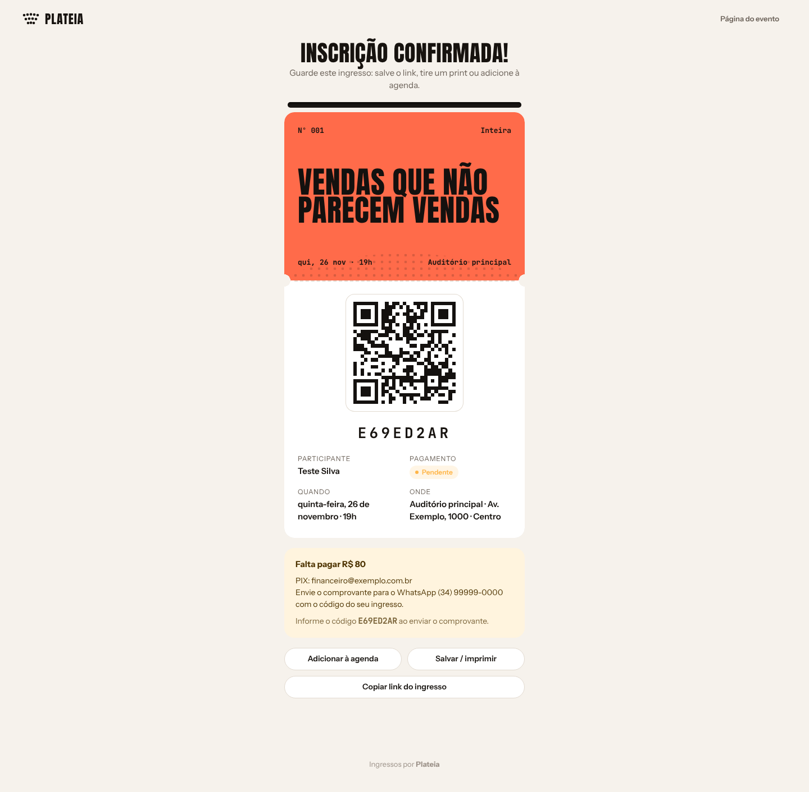

# Plateia

Sistema de ingressos para palestrantes e representantes que fazem eventos na casa.
O organizador acompanha quem confirmou, quem pagou e quem entrou; o público se inscreve por uma página própria e recebe um ingresso com QR code.

Mesma tecnologia dos outros sistemas: **C# / .NET 8, ASP.NET Core MVC, Entity Framework Core 8 e MySQL 8 (Pomelo)**. CSS e JS sem bibliotecas.


## O que já faz

| Área | Funções |
|---|---|
| **Meus eventos** | Cartões no formato de ingresso com capacidade, confirmados, pagos e a receber. |
| **Painel do evento** | Grade de assentos (pago, pendente, cortesia, presente, livre); anel de pagamentos com valor recebido e a receber; check-in; vendas por tipo de ingresso; inscrições dos últimos 14 dias; feed "ao vivo" que se atualiza sozinho a cada 30 s. |
| **Participantes** | Filtros com contagem (todos, pagos, pendentes, cortesia, presentes, cancelados); busca por nome, e-mail, telefone ou código; marcar entrada com um clique; marcar pago (PIX/dinheiro), cortesia ou pendente; cobrar ou enviar o ingresso pelo WhatsApp; cancelar; ações em lote; adicionar participante manualmente; exportar planilha (CSV para Excel). |
| **Check-in (portaria)** | Campo para leitor de QR USB ou digitação; câmera do celular (Chrome no Android); avisa se a pessoa já entrou, se o código é inválido, se a inscrição foi cancelada ou se o pagamento está pendente (dá para receber na hora e liberar). |
| **Evento** | Nome, chamada, descrição, data, local, capacidade, cor, vários tipos de ingresso (preço e limite próprios), instruções de pagamento, rascunho/publicado/encerrado/cancelado, abrir/fechar inscrições. |
| **Página pública** `/e/{evento}` | Capa gerada com a cor do evento, escolha do ingresso, aviso de "restam X lugares", inscrição. Rascunho só aparece para o organizador (prévia). |
| **Ingresso** `/ingresso/{código}` | QR code, código, situação do pagamento com instruções (PIX), adicionar à agenda (.ics), imprimir. |
| **Organizadores (administrador)** | Criar acesso com senha temporária, gerar nova senha, desativar. |

**Perfis:** Organizador vê só os próprios eventos · Administrador vê todos e cadastra organizadores.

**Pagamento:** não há cobrança automática (gateway). A pessoa recebe as instruções no ingresso e o organizador marca como pago.

## Estrutura

```
src/
  Plateia.Domain          entidades (Usuario, Evento, TipoIngresso, Inscricao)
  Plateia.Application     regras (EventoService, InscricaoService, ResumoEvento)
  Plateia.Infrastructure  banco (AppDbContext, migrações)
  Plateia.Web             telas (MVC + Razor), CSS e JS
banco/criar-banco.sql     cria o banco Plateia e o usuário próprio
```

## Banco de dados

Usa **o mesmo servidor MySQL dos outros sistemas, mas um banco separado (`Plateia`) com usuário próprio**, que só tem permissão nesse banco.

1. Abra `banco/criar-banco.sql`, troque `TROQUE_ESTA_SENHA` por uma senha forte e rode no MySQL com um usuário administrador.
2. As tabelas são criadas sozinhas na primeira vez que o sistema sobe (migrações do Entity Framework).

## Configuração

Nada de senha no código: tudo vem de variáveis de ambiente (veja `.env.exemplo`).

| Variável | Para quê |
|---|---|
| `ConnectionStrings__Plateia` | Conexão com o banco `Plateia` (usuário `plateia`). |
| `Admin__Email`, `Admin__Senha`, `Admin__Nome` | Cria o primeiro administrador quando o banco está vazio. Depois pode remover. |
| `Demo__Criar` | `true` cria eventos e participantes fictícios (só se não houver eventos). Use apenas para demonstração. |

## Rodar localmente

```bash
cd src/Plateia.Web
export ConnectionStrings__Plateia="Server=127.0.0.1;Database=Plateia;User=plateia;Password=..."
export Admin__Email="seu@email" Admin__Senha="umaSenhaForte"
dotnet run
```

Com `Demo__Criar=true`, entre também como organizador de exemplo: `demo@plateia.local` / `demo12345`.

## Segurança

- Código do ingresso aleatório de 8 caracteres (sem letras ambíguas), único.
- Inscrição trava a linha do evento durante a contagem: dois pedidos simultâneos não ocupam o mesmo último lugar.
- Mesmo e-mail não se inscreve duas vezes no mesmo evento pelo site.
- Limite de 10 envios por minuto por IP no login e na inscrição; antiforgery em todos os formulários.
- Organizador só acessa os próprios eventos (os outros respondem 404).
- Planilha exportada protegida contra fórmulas do Excel.

## Nova migração (quando mudar as entidades)

```bash
dotnet tool install --global dotnet-ef --version 8.0.10
cd src
ConnectionStrings__Plateia="Server=localhost;Database=Plateia;User=x;Password=x" \
  dotnet ef migrations add NomeDaMudanca -p Plateia.Infrastructure -s Plateia.Web -o Migrations
```

## Telas

| Página pública | Ingresso | Participantes |
|---|---|---|
|  |  |  |
